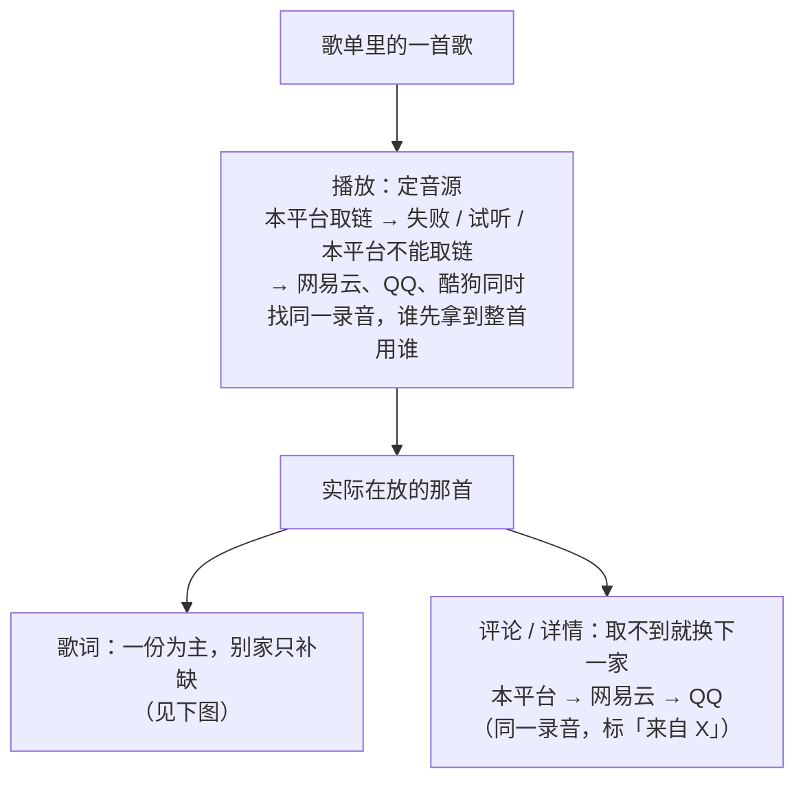
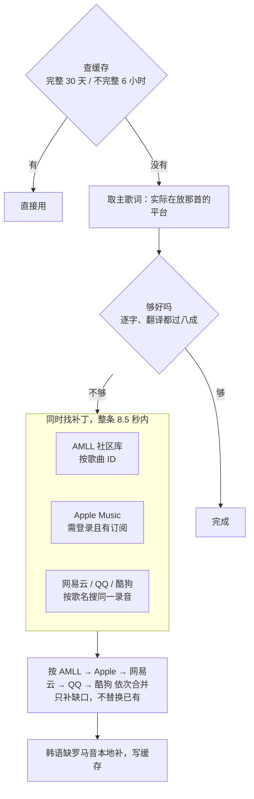

# Music Nebula — 前端架构（App.tsx 收敛计划 v1）

> 本文档是 App.tsx 领域化重构的唯一架构真源，随迁移步骤同步更新。
> 依赖规则由 `scripts/check-arch.mjs` 机制化执行（`pnpm check:arch`，并随 `pnpm qa` 运行）。

---

## 1. 目标

2026-11 后端整修补充：`lib/audio/desktopPlayback.ts` 负责点播解析及音质请求接线，App 只注册解析器与回调。`AudioPlayer` 的播放代次隔离迟到异步结果；跨曲切换先停止旧媒体。`lib/playlist/ipcClient.ts` 保留平台元信息，远程临时地址不进入会话持久化。

- 把 1411 行的 App.tsx 收敛为「组合层」：领域 hooks 提供状态与行为，视图区块按 Z 轴组装，App 只做接线。
- 纯结构整理：**行为零变化**；不引入状态库、不重写 panEngine / AudioPlayer。
- 低成本重渲染隔离：App 顶层不再订阅全量播放器状态；高频值（currentTime/progress）留在叶子订阅。

## 2. 领域清单（12 hooks + 2 services）

### Services（lib 单例，非 React）

| Service | 职责 | 约束 |
| --- | --- | --- |
| `audioPlayer`（已有） | 播放/队列/模式 | 全局单例，leaf 可订阅 |
| `LibraryService`（新增 `src/lib/library.ts`） | **仅 track/catalog 数据**（songs） | **不持有 currentPlaylist**；`applyImported` 是唯一外部导入入口 |
| `lib/glass/`（2026-11 新增） | 光学材质：材质档位参数、位移贴图、GlassManager（每个 G1/G2 玻璃面、以及 G3 的两侧面板各一个 SVG 折射滤镜）、`useGlass` | 只写材质相关的 CSS 变量与 SVG 滤镜；主题由 `useInterfaceSettings` 调用 `applyGlassTheme` |
| `lib/environment.ts`（2026-11 新增） | 环境光取色（k-means）→ 根节点 `--e1/--e2/--e3/--ebase/--acc/--tint-adapt` | 由 `useBackground` 调用（背景领域"只写自己的环境光 CSS 变量"）；不触碰歌词状态 |
| `lib/listenMode.ts`（2026-11 新增） | 漫游 / 聆听注意力交接引擎（NEBULA_UI_SYSTEM §7.1）：静止检测、0→1 交接曲线，写根元素 `--lk/--lo/--ls` 与 `data-listen-*`；`listenBus` 供舞台帧循环读取「散开」位移 | 由 `useListenMode` 接线；只写交接相关的变量和属性，视觉由 CSS 完成；舞台通过 `onListenFrame` 订阅刷新 |
| `components/icons.tsx`（2026-11-14 新增） | 统一图标集（关闭、左右箭头、播放、爱心、勾、准星、音符），24 网格 1.7 线宽 | 界面里不再用字符当图标；播放器底栏的 `player/icons.tsx` 暂时独立 |
| `lib/space/`（2026-11-16 新增，#133–#139） | 主舞台星云（NEBULA_UI_SYSTEM §8.0）：`world.ts`（首尾相接的画布、三种排法、歌手名空地、`queryRect` / `zoomFloor` / `searchTarget`）、`lens.ts`（透镜投影）、`stars.ts`（卡片下面的小封面画布与歌手名）、`active.ts`（当前星云、卡片初始样式与透明度）、`lab.ts`（排法设置与开发者面板「舞台实验室」）、`tone.ts` / `thumbs.ts`（封面色调与缩略图） | 由 `useStage` 的帧循环驱动；纯数据部分（`world.ts`、`lens.ts`）不碰 DOM。旧卡片墙（`layout.ts` 的周期回绕、`fisheye.ts`、`spatial.ts`、搜索聚簇）已在 #139 删除 |
| `lib/metaOverlap.ts`、`lib/shareLink.ts`（2026-11-14 新增） | 星云卡片标题防压盖（四边形求交，纯函数）；歌曲分享链接（按平台生成页面地址） | 前者由 `useStage` 的帧循环每帧调用；后者由右键菜单「复制链接」使用 |
| `lib/overlayScrollbar.ts`（2026-11-14 新增） | 悬浮滚动条（NEBULA_UI_SYSTEM §9.7）：隐藏原生滚动条，在滚动容器的定位祖先上叠一根细条，滚动 / 悬停时淡入、可拖动 | `useOverlayScrollbar(ref, active)`；侧面板、弹窗、播放队列、搜索结果在用；不改动元素的定位方式 |
| `components/EmptyNebula.tsx` + `empty-nebula.css`（2026-11-14 新增） | 首次启动空状态（§9.8）：空卡轮廓、标题与三个入口；`useEmptyPhase` 管淡出；`.app[data-no-song]` 时隐藏播放条与回到中心 | 由 App 在曲库为空且无会话可恢复时挂载；演示星云只在 `isDemoNebulaEnabled()`（`?demo=1`）时生成 |
| `components/modals.css`（2026-11-14 新增） | 信息弹窗（歌曲详情、评论、歌手、专辑）的全部样式（§9.4），`.mdl-*` | 由 `InfoModals.tsx` 引入；旧 `.info-modal` 内部样式已从 styles.css 删除，`.info-overlay` / `.info-veil` 仍在 styles.css |
| `lib/listen/`（2026-11-16 新增，Player P2） | 听音空间的歌词阅读栏（NEBULA_UI_SYSTEM §7.2）：`words.ts`（#124 抽出的逐字层：拆字、量宽、波浪、着色、每帧逐字状态，听音空间与星云上的空域歌词 `LyricsLayer`、设置预览共用；样式在 `components/listen/lyric-words.css`，作用于 `.lw` 根）、`engine.ts`（纯 DOM 引擎：弹簧滚动、景深、环境透色、逐字波浪、长音、快歌自适应、滚轮浏览）、`model.ts`（`LyricLineUI[]` → 引擎条目、间奏、密度、文字判断；`toEngineLine` 单句转换两边共用）、`settings.ts`（听音空间歌词设置 store，`music-nebula.listen-lyrics`）、`palette.ts`（封面 → 歌词主色 `--ly-a` / `--ly-b`，由 `environment.ts` 写到根元素）、`coverUrl.ts`（大封面换高清地址） | 引擎不依赖 React；歌词栏祖先不得建立层叠上下文（环境透色要和背后混合） |
| `public/fonts/` + `lib/fonts.ts`（2026-11-16 新增） | 随软件打包的字体（Newsreader、Inter、思源宋体 KR 分块）与 `fonts.css`、OFL 授权文件；`loadBundledFonts()` 在 `main.tsx` 渲染前插入指向 `fonts/fonts.css` 的样式表链接 | 放在 public 里由 Vite 原样复制到输出目录，不会被单文件构建内联；地址按页面地址解析，桌面版 file:// 和网页版都可用 |
| `lib/quality.ts` + `src/main/quality.ts`（2026-11-16 新增，#120） | 前端：各平台音质标识的中文名、播放条代号、平台名；后端：跨平台保真度阶梯 `mapQualityTo`（兜底到别的平台时把偏好换成同级档位）与环绕声效果版集合 `EFFECT_LEVELS` | 音质显示以实际供流为准：Track 的 `via` 记兜底平台，音质列表与切换都按它来 |
| `components/listen/`（2026-11-16 新增，Player P2） | `ListenSpace`（听音空间外壳：封面一镜到底、星云后退、左侧信息、右栏原地详情、翻译开关）、`LyricColumn`（引擎的 React 包装 + 平滑时钟）、`ListenPreview`（设置里的实时预览，同一引擎紧凑模式） | 取代 `NowPlayingPanel`（已删除）；由 `OverlayStack` 常驻挂载，`useOverlays.nowPlayingOpen` 控制开合；听音空间打开时 `useOverlays` 把详情 / 歌手 / 专辑 / 评论路由到右栏（`InfoPane`，`InfoModals` 的 pane 呈现方式） |
| `components/dock/`（2026-11 新增，非区块） | `SideDock`（两侧 Dock 机制与外壳：光痕、G2 小球、G3 固定侧面板、点外面 / Esc 关闭）+ `panel-kit.css`（面板共用基础件）+ `left-panel.css` / `right-panel.css` | 被 `PlaylistDock` / `AccountDock` 两个区块使用；只做外壳，内容由区块提供；样式限定在 `.sd-panel` 内 |
| `lib/perf.ts`（2026-11 新增） | 性能自动降级（NEBULA_UI_SYSTEM §3.7）：帧监测（每 10 秒采样 2 秒）+ 档位应用（材质交给 GlassManager，环境光漂移由根节点 `data-perf` 驱动 CSS） | 由 `useInterfaceSettings` 调用（「性能优先」开关 + 自动档位）；不触碰其他领域状态 |

> 概念边界：`LibraryService → PlaylistService/usePlaylist → audioPlayer`。第一阶段若只做一个 service，也**不得**让 LibraryService 变成万能音乐状态容器。

### Hooks（按领域目录 `src/hooks/<domain>/`）

| Hook | 领域 | 拥有 | 依赖 |
| --- | --- | --- | --- |
| `useAccounts` | 账号 | platforms / accounts / loginNonce / drawerPlatform；启动探活、refresh、requestLogin | 无 hook 依赖 |
| `useLibrary` | 曲库 | LibraryService 的 React 订阅适配层（**无业务逻辑**） | LibraryService |
| `usePlaylist` | 歌单生命周期/队列 | 当前歌单身份、playPlaylistFromStart / playSongFromList / insertNextSong | LibraryService + audioPlayer |
| `usePlaylistImport` | 导入流程 | importStatus / importMessage / importing / localBusy + 手动/平台/本地导入 | LibraryService（applyImported） |
| `useOverlays` | 浮层 | contextMenu / infoModal / nowPlayingOpen / modeToast | audioPlayer |
| `useLyrics` | 歌词运行态 | lyricLines / 拉取/归一化（随切歌） | audioPlayer（service） |
| `useBackground` | 背景/氛围 | bgSetting / bgCoverMode；产出 **VisualAtmosphere**（不直接改歌词/玻璃） | 无 hook 依赖 |
| `useInterfaceSettings` | 界面设置 | lyricSettings、uiHideCards、uiHideLyrics、lyricTranslationEnabled + 持久化 | 无 hook 依赖 |
| `useSearchCluster` | 搜索 | searchMatches + 定位 handlers：卡片不动，镜头飞到命中（#139 起不再聚簇）；歌曲数据来自 App 传参（songs prop） | 不依赖 usePlaylist |
| `useEdgePanels` | 边缘面板 | edge 状态 + 热点/防抖计时器 | 无 hook 依赖 |
| `useStage` | 画布（最后迁移） | hoveredId / visibleIds / failedIds / likedIds + 舞台接线 | LibraryService + audioPlayer |
| `useListenMode`（2026-11 新增） | 漫游 / 聆听交接 | 只做接线：创建 ListenDirector、按设置 configure；阻断条件由 App 汇总传入 | audioPlayer（service）；无 hook 依赖 |

## 3. 依赖图（DAG）

```
lib/（audioPlayer · LibraryService · atmosphere 纯函数 · 既有模块）
   ▲
   │ 全部 hooks 可依赖（Hook → Service/lib ✔）
hooks/（默认禁止跨领域；白名单为空集；逃生口：基础层被上层依赖，需登记）
   ▲
contexts（VisualAtmosphere / Playback / InterfaceSettings）只被组件消费
   ▲
view blocks（同层互不依赖，组合只由 App 完成）
```

跨域数据一律经 service / context / App 组合层传参；**不写死"hooks 永远不能互相调用"**，白名单机制保留。

## 4. Context 清单（仅这三个，禁止大全局 context）

| Context | 值 | 高频值 |
| --- | --- | --- |
| `PlaybackProvider` | `{ song, playing, mode, quality, loading, failed, error, qualities }` | 不含 currentTime / duration / progress |
| `InterfaceSettingsProvider` | `{ lyricSettings, uiHideCards, uiHideLyrics, lyricTranslationEnabled }` + setters | — |
| `VisualAtmosphereProvider` | `{ palette, sample, coverMode, effectiveBg }` | — |

高频订阅（`useAudioPlayer()` 叶子）：`LyricsLayer`（Z1 歌词进度）、`BottomPlayer`（进度条/时间）、`ListenSpace`（听音空间；歌词阅读栏按帧读 `audioPlayer.position()`，不靠 React 重渲染）。

> 实现注记：`PlaybackProvider` 挂在入口（`main.tsx`），因为 App 自身也消费低频播放状态——
> Provider 若由 App 渲染，则无法给 App 自身供值。其余两个 Provider 的值由 App 组合层
> 用 `useMemo` 生成并下传子区块，App 不消费它们。

## 5. 视图区块（按 Z 轴 + 功能边界）

| 区块 | 内容 | 备注 |
| --- | --- | --- |
| Z0 | `BackgroundLayer` | 已有组件 |
| Z1 | `LyricsOverlay` | 歌词层 + 隐藏开关 |
| Z2 | `StageCanvas` | stage-3d + 卡片渲染（收 useStage 数据） |
| Z3 | `BottomBar` + 回中按钮 | BottomBar 已有 |
| HUD | `TopBar` / `AccountDock` / `PlaylistDock` | 三者独立，**不合体** |
| Z4 | `OverlayStack` | NowPlaying + InfoModals + 右键菜单 + toast |
| Dev | `LyricSourceProbe` | 开发者工具：歌词来源 / 逐字覆盖面板（默认隐藏，Ctrl+Shift+L）；只读 `useLyrics` 的 `lyricDebugInfo`，不参与正式界面 |

## 6. Dependency Rules（check-arch 强制）

1. `lib` 不得 import `hooks` / `components`。
2. `hooks` 禁止跨领域依赖；基础层可被上层依赖，禁止反向；依赖以白名单为准。
3. 同层 UI 区块禁止互相依赖，组合只能由上层容器（App）完成。
4. Background 不得修改 Lyrics 状态（只经 VisualAtmosphere 中间层）。
5. Stage 不得接触 Account 状态。
6. `applyImported` 是曲库唯一外部导入入口，不演化成通用 mutation。
7. `components` 允许直接 import `lib` 纯函数/类型（例外保留）。

## 7. 迁移路线（插花式，每步 build + qa + 提交）

- [x] 1. `useAccounts`
- [x] 2. `LibraryService` + `useLibrary` + `usePlaylist` + `usePlaylistImport`（含 `lib/playlistTypes.ts` 共享类型；会话记忆效果暂留 App，随 Stage 步迁移）
- [x] 3. `useOverlays`
- [x] 4. 视图第一阶段（OverlayStack 抽取 + HUD/BottomBar memo 化 + 稳定回调接线）
- [x] 5. `useLyrics`（含 `lib/lyricSettings.ts` 共享类型；翻译开关更名 lyricTranslationEnabled）
- [x] 6. `useBackground`（含 VisualAtmosphere 中间层迁移）+ `useInterfaceSettings`
- [x] 7. `useSearchCluster` + `useEdgePanels`
- [x] 8. 视图第二阶段（三 Context 落地 + 区块化：Playback / InterfaceSettings / VisualAtmosphere；LyricsLayer / NowPlayingPanel 叶子化；OverlayStack props 收敛；check-arch 修扩展名解析）
- [x] 9. `useStage`（最后，最高风险：hovered/visible/failed/liked/渐进揭示/PanController/虚拟化数据全部收敛；App 仅剩组合接线）


## 后端链路总览（2026-11-19，#195；新会话先看这一节）

后端只有三条链路，形状各不相同。下面两张图是现状的唯一总图，改了任何一条链路的结构都要回来更新。



- **播放**（`SongResolver`，整条 ≤6 秒）：能本平台取链的是网易云、QQ、酷狗、酷我、波点（`PLAYABLE`）；汽水、Spotify、YouTube Music、Apple Music 永远直接走兜底。兜底时各家**并行**，各取最多 2 个通过同一录音判定的候选，第一个拿到整首的胜出（不是按顺序一家家试）。例外：QQ 登录过期时不兜底，提示重新登录。
- **关键约定**：歌词、评论、详情都以**实际在放的那首**为准（前端 `streamTrack`），不是歌单里的原曲。原曲只作为 `origin` 提供查询用的 id（#195 起，歌词用）。
- **评论 / 详情**（`LyricService.fetchComments` / `fetchSongDetail`）：依次兜底；翻页沿用第 0 页定下的来源。



- 合并规则（`lyricAlignment.enrichAligned`）：先试固定偏移对齐，不行再按正文逐行配对；只有对方的逐字确实更多时才换时间轴。主歌词没有正文时，第一个可用来源当正文：按 id 确认的同一录音（AMLL 第一轮、Apple 目录 id）保留逐字，其余要和实际在放那首时长差 ≤2 秒才保留逐字。
- 歌词来源细节见下面「歌词新来源（#195）」。

## 后端整修 #B3：请求与媒体生命周期

- `src/main/requestScope.ts`：AsyncLocalStorage 传播父截止时间/取消，阶段结束回收子请求；调用者取消经 preload → IPC → resolver → HTTP/Axios/probe。
- `SongResolver`：总时限 6000ms、主源 3500ms、单次取链 2300ms、搜索 1600ms、探测 1600ms，全部受父预算约束；最多两个其他平台并发，每个平台最多两个安全候选。阶段值经 #B7 实测调整；主源慢响应仍受总预算约束。
- URL 解析缓存 256 项/120 秒（cachedUntil），匹配缓存 512 项/24 小时；缓存期限不截短返回音频 expiresAt。网易云 expi、QQ expiration 以秒转成请求时刻起的绝对期限；未提供期限时按 sourceLifetime 策略：网易云/酷狗15分钟、QQ30分钟，未知平台10分钟。AudioPlayer 按曲目/地址保留 resolvedAt/expiresAt，没有跨曲目 loadedAt；提前5秒或媒体实际出错才刷新。强制刷新绕过 URL/探测缓存；Cookie 更新和退出登录清空账号相关结果。
- `createFallbackPriorityProvider` 返回可 `invalidate()` 的函数；5 分钟后台权益刷新，单平台 2 秒，点播直接读快照。
- `AudioProxy.start()` 为 Promise，Electron 必须等监听成功；只回传当前实例代理地址。每实例 16 个活动请求、每协议代理最多 16 个 socket/每域 8 个。
- `resolveSong(track,quality,{requestId,forceRefresh})` 与 `cancelResolve(requestId)`：请求标识只在发起它的 webContents 内生效，销毁窗口会取消；旧调用方式仍可用。
- AudioPlayer 临近结束预取下一首，不预播放；新媒体接管前解除旧元素监听，始终只有当前媒体出声。
- `AudioPlayerState.playIntent` 从内部播放意图直接生成；按钮使用它，进度和可听状态仍使用playing。终止型PlaybackResolutionError保留现有错误栏，停止自动跳歌。
- `qqSession.ts` 统一音乐身份/票据、登录探针和状态缓存：valid5分钟、expired30秒、unknown15秒，最多16个凭据摘要；不缓存明文票据值。首次取链把登录探针合并到同批请求，成功缓存期内不额外核验。QQ会员查询采用当前账号的VipQuery V2/V1及VipLogin，正值最多5分钟且不越过会员期限、明确普通30秒、未知15秒；Cookie变更清空登录和权益缓存。AUTH_EXPIRED阻止QQ主源缓存与兜底，不将未知网络结果说成无权限。


## 后端整修 #B5：歌词路由

实际供流 Track → 同身份主歌词（3200ms）→ QQ/酷狗/网易云其他来源并行搜索（1800ms）与取词（3200ms），全过程受 8500ms 截止时间约束。复用 recordingMatch；跨源以唯一正文锚点确认偏移（至少 3 个、覆盖半段以上、95% 残差≤180ms、最大≤500ms、偏移≤8s）。未通过则保留主源。

网易云内部 lyric_new/lyric 并发、每个 2800ms，早于服务阶段退出；一个接口挂起时保留另一个的合法结果。

`fetchLyric(track,{requestId})` 与播放共用所有者隔离的 `cancelResolve` 通道。Lyrics hook 的身份键包含实际供流平台/ID，来源变化立即清空旧歌词。`lyricAlignment.ts` 负责覆盖统计和合并，`timedLyrics.ts` 负责真实 QRC/KRC 转换；`LyricCache.flush()` 可用于测试/退出前持久化。

## 后端整修 #B6：封面元数据

导入 Track 带可选 `coverInfo`，候选 URL 不等于已验证尺寸。`nebulaAPI.coverInfo(track)` → `nebula:cover-info` → CoverService 返回 `{url,width?,height?,verified}`。仅 `verified=true` 的尺寸来自真实图像头；失败保留原图，不重采样。该接口按需使用，不阻塞播放，听音空间尺寸展示由主线接入。网易云匿名初始化在 Electron 启动预热；主平台不受兜底熔断阻止。

## 后端合入主线后的补充（#154–#166，2026-11-17）

- **同一录音判定**（`recordingMatch.ts`）：是取链兜底、歌词补全、评论和详情兜底共用的唯一门禁。
  - 版本词包括「版」和伴奏 / 语种 / 器乐 / 剪辑 / 倍速类词。
  - 中日韩文括注当译名；英文标题后认不出的英文括注保守算版本。
  - `searchKeyword(track)` 生成跨平台搜索词：去掉译名、Explicit 括注和歌手末尾的读音别名。
- **歌词补全对齐**（`lyricAlignment.ts`）：
  - 先试固定偏移对齐 `alignTimelines`。
  - 失败再用 `retimeByText` 按正文逐行配对，同时满足以下条件才改用对方的行时间和逐字时间轴：
    - 顺序一致、正文相同；
    - 单行差 ≤1.2 秒；
    - 配上八成以上；
    - 中位差 ≤0.6 秒。
  - 正文行排除所有「短标签 + 冒号」的署名行。
  - 本平台没有正文时，兜底歌词是同一录音且时长差 ≤2 秒才保留逐字（`lyricService.fetchLyric`）。
- **韩语罗马音**：`parsers/romanizeKorean.ts`（按发音的修订罗马字，无依赖）+ `lyricService.withKoreanRoman`。
  - 只补平台没给的韩文行，每行用原文的时间戳；
  - 缓存读出时也补；
  - 前端按原文逐字对齐拼词（#167）。
- **评论 / 歌曲详情兜底**（`lyricService`）：
  - `counterpart(track)` 去网易云 → QQ 找同一录音，缓存 6 小时。
  - `fetchComments`：本平台为空或失败才兜底；第 0 页定来源，翻页同源。
  - `fetchSongDetail(track,{withCredits})`：本平台取不到用对方详情；`withCredits` 时缺制作人员再去别的平台补，上限 3 秒。
  - 结果带 `source:{platform,sourceId,fallback}` / `creditsFrom`，前端用 `sourceLabel` 写「来自 X」。
- **酷狗**：
  - 手机端扫码登录（`kugouLogin.createQr/pollLogin`），票据带 `kg_client=mobile`。
  - 我的歌单、歌单歌曲走手机端签名：参数按 key 排序后直接拼接，不加 &。
  - `getAccount` 实际请求歌单接口核验，20017 = 票据失效。
- **Spotify**：`SPOTIFY_CLIENT_ID` 默认用桌面客户端公开 ID，回调 `http://127.0.0.1:5588/login`；`fetchMe()` 区分 401 过期和暂时查不到。
- 平台 × 功能完成度：`docs/project/PLATFORM_MATRIX.md`。每补一个缺口就改那张表。

## 加一个平台要改的地方（2026-11-18，#180 接酷我时整理）

平台名单没有单一来源，下面这些地方都要改，漏一处就会出现「登录了但不能播」「导入报不支持」之类的静默失败：

- **类型与注册**：`src/main/types.ts` 的 `Platform`；`adapters/index.ts` 的 `createAdapters`（`Record<Platform,…>`，漏了编译报错）和 `resolveAdapterByUrl`（歌单链接识别）；`http.ts` 的 `PLATFORM_HEADERS`；`src/main/index.ts` 导出。
- **播放**：`services/songResolver.ts` 的 `PLAYABLE`（不在里面的平台不会用本平台取链，也不会被当兜底）和 `LEVELS`；`services/platformRouter.ts` 的兜底候选（只有想让它给别的平台兜底时才加）；`audioProxy.ts` 的 `HOSTS`（音频域名不在里面会 403）；`electron/main.cjs` 的请求头注入和跨域放行。
- **登录**：`login/<平台>Login.ts` 的 `getAccount`；`cookieStore.ts` 的 `validatePlatformCookie`；`login/index.ts` 的 `create<平台>LoginAdapter`（`kind`：qr / window / oauth）；`main.cjs` 的 `loginAdapters` 和登录函数（官方网页登录用内嵌页面弹窗 `sheetHost`，独立 partition，退出登录时在 `onCookieClear` 里一并清空；需要 Google 账号的走默认浏览器）；`ipc.ts` 的登录通道、`preload.cjs`、`lib/playlist/ipcClient.ts` 的类型。注意 `qq-session-regression` 会按源码文本截取 `createQqLoginWindow(` 到 `createKugouLoginWindow(` 之间执行，新函数不要插在这两者中间。
- **封面**：`services/coverService.ts` 的改写规则与允许的图片域名。
- **前端**：新的登录方式（`kind`）不用改启动探活（`useAccounts` 只跳过 unavailable，#187）；`components/platforms.ts`（名称、logo、`DOCK_PLATFORM_ORDER`）；`AccountDock.tsx` 的 `<平台>Login` 组件、`PlatformLogin` 分支、`LOGIN_HOW`；`lib/quality.ts` 的 `PLATFORM_NAME`；`SearchBar.tsx` 的 `platformLabel`；`lib/shareLink.ts`；`PlaylistDock.tsx` 与 `EmptyNebula.tsx` 里列平台名的文字。
- **测试**：`scripts/import-regression.mjs` 加该平台的样例；新增 `scripts/<平台>-regression.mjs` 接入 `qa:backend`；`router-regression` 要照常通过。
- **文档**：`PLATFORM_MATRIX.md` 加一列。

## YouTube Music（#185，2026-11-18）

- 只能走 YouTube 电视端（TVHTML5）身份：Google 现在只认它签的 OAuth 令牌，带去 YouTube Music 网页端（WEB_REMIX）接口一律 400。客户端身份（client_id / secret）运行时从 `youtube.com/tv` 的 base-js 脚本里抓，进程内缓存，不硬编码、不写日志、不落盘。
- `adapters/ytmusicAdapter.ts`：`YtmusicClient` 负责客户端身份、设备码、换令牌、续期（单飞，写入超过 50 分钟或遇 401 先续；refresh_token 不轮换；invalid_grant 记下该令牌判过期）和 youtubei 调用（`/youtubei/v1/browse`、`account/accounts_list`，未登录按匿名读公开歌单）；`YtmusicAdapter` 负责我的歌单（`FEplaylist_aggregation` + `FEmusic_liked_playlists` 合并去重，LL 排第一叫「赞过的视频」，跳过 WL / LM / RD）和歌单内容（`VL<id>` + continuation 翻页，到 60 页或整页没新 ID 停；LL 丢掉超过 15 分钟的视频）。不实现 `getAuthStatus`：曲目靠跨平台兜底播放，登录过期不该拒播。
- `login/ytmusicLogin.ts`：登录类型 `kind: 'device'`，沿用扫码的 createQr / pollLogin 两条通道；device_code 只留在主进程，前端只拿 userCode 和验证地址；主进程按 Google 给的 interval 控制轮询频率，slow_down 加 5 秒。令牌存 CookieStore 的 `ytmusic`（cookies = access_token，token = refresh_token）。退出登录时 `onCookieClear` 拿到清除前的记录，尽力撤销 refresh_token。
- 前端 `AccountDock.tsx` 的 `YtmusicLogin`：三步说明；大号代码整块点击复制；授权页地址是可点击的链接（默认浏览器打开，文字可选中）并带「复制链接」；主按钮「复制代码并打开授权页」（#186）。
- 回归：`scripts/ytmusic-regression.mjs`（23 项，离线）。

## 歌词新来源：AMLL 社区库与 Apple 逐字歌词（#195，2026-11-19）

- **TTML 解析**（`parsers/ttml.ts`，自写，不依赖 XML 库；参考项目用的解析库是 AGPL，不能用）：`parseTtml` 支持 `itunes:timing` Word / Line、各种时间格式、嵌套 span、英文词间空格并到前一个词、实体；翻译 / 罗马音两种写法都认——行内 `ttm:role="x-translation"` / `"x-roman"`（AMLL）和 `<head>` 里按 `itunes:key` 对应的 `<translations>` / `<transliterations>`（Apple，优先 zh-Hans）。背景人声 `x-bg`（连同它的翻译）第一版丢掉；`ttm:agent`（对唱）不读。严格模式：带 DTD、结构错误、超过 2MB 一律返回空结果。`fromTtml` 产出与 QRC / KRC 相同的 `Lyric`（逐字转成 YRC 文本）。
- **AMLL**（`services/amllLyrics.ts`）：`GET https://api.amll.dev/v1/lyrics/get?<键>=<id>`，键按 ncm → qq → apple → spotify → isrc 的顺序有哪个用哪个，命中即停（同一首最多 3 次请求）。QQ 只认数字 songid（`extra.songId`），songmid 查不到。命中后核对记录的 id 列表确实含查询的 id。走 `HttpClient.requestRaw`，只带歌曲 id，不带 Cookie / 账号信息。缓存：命中 24 小时、未收录 6 小时，最多 1000 条；429 / 5xx 后 5 分钟全局熔断。
- **Apple 逐字歌词**（`services/appleMusicLyrics.ts`）：只有 CookieStore 里有 Apple 登录标记时才工作（没有就不唤起页面）。原曲或实际在放那首是 Apple 曲目时按目录 id 直取；否则用「歌名 + 第一个歌手」搜 Apple 目录，候选经 `recordingMatch` 判同一录音再取。请求 `/v1/catalog/{地区}/songs/{id}/syllable-lyrics?l=zh-Hans-CN&extend=ttmlLocalizations`（带中文翻译）；页面引擎白名单相应放行 `ttml` / `ttmlLocalizations`（单个 ≤2MB）和搜索结果 `results.songs.data`。总时限 4 秒，有缓存。
- **并入 `LyricService.fetchLyric(track, signal, origin?)`**：只在主歌词不够好时查；AMLL 第一轮（实际在放那首 + 原曲的 id）、Apple 与网易云 / QQ / 酷狗搜索并行；AMLL 第一轮没命中而搜索找到了网易云 / QQ 的同一首时，用它们的 id 再查一次（只用整体截止前剩余时间，命中后按那首的时长核对逐字）。各自预算：AMLL 3.5 秒（第二轮 ≤2.5 秒）、Apple 4.2 秒；任一来源失败 / 超时都不影响其余。`provenance` 记 `amll` / `applemusic`，开发者面板（Ctrl+Shift+L）显示「AMLL 社区库」「Apple Music」。
- **前端**：兜底播放时 `useLyrics` 多传 `origin: toBackendTrack(song)`，缓存键和歌词身份仍按实际在放那首。
- 回归：`ttml-regression`（17 项）、`lyric-sources-regression`（23 项），引擎回归加 3 项。

## Apple Music（#191，2026-11-19）

- 路线：在官方网页播放器里读（交接文档的路线 A）。Apple Music 的接口要开发者令牌加用户令牌，两个都只在 music.apple.com 页面里；页面自带的 MusicKit 替我们带令牌去请求。**令牌不出页面、不写日志、不落盘**。
- `electron/appleMusicEngine.cjs`（`createAppleMusicEngine`，依赖由调用方传入，可离线单测）：
  - 一个从不挂到窗口上的 `WebContentsView`，分区 `persist:applemusic-login`，`backgroundThrottling: false`，UA 去掉 Electron 片段。第一次用到时才创建和加载（没用过 Apple 的用户启动时不加载 music.apple.com）。
  - `call({ path, query })`：等页面里 `MusicKit.getInstance()` 出现（最多 25 秒），串行执行一段固定的读取函数 `readInPage`，路径只认 `/v1/me/…`、`/v1/catalog/…`；页面里按白名单挑字段（曲目基本信息、artwork、playParams、tags、`relationships.catalog` 的 id 和 isrc、`next`、`meta.total`、`meta.subscription.active`、错误码），主进程再过一遍。兼容 `mk.api.v3.music` 和 `mk.api.music`（实测 Electron 43 下只有后者），4xx 可能 resolve 也可能抛。
  - `callMany(reqs)`（#192）：一批请求占队列里一个位置，页面里用同一个读取函数限并发（6）并行跑，结果按顺序返回；最多 60 个。目前只用来读歌单曲目数。
  - `login()`：已登录直接成功；否则把同一个视图交给 `sheetHost.open({ view })` 显示在内嵌弹窗里，每 1.5 秒查 `mk.isAuthorized`，登上就收起（只摘下，不销毁）。`logout()`：页面里 `unauthorize`，再清空分区全部存储。导航只放行 `*.apple.com` 的 https。
- `adapters/applemusicAdapter.ts`：`AppleMusicClient`（可注入的桥 `setBridge`，Electron 启动时注入引擎；错误分类：401 过期、40015 没有订阅、403 本次受限、页面没就绪）+ `AppleMusicAdapter`（我的歌单带 `extend=tags`，「喜爱」排前；资料库歌单曲目带 `include=catalog`——资料库曲目自己没有 isrc，要从对应的目录曲目拿；公开歌单 id 记成 `{地区}:pl.…`；`fetchSongUrl` / `fetchLyric` 返回 null 走跨平台兜底，不实现 `getAuthStatus`）。
- `login/applemusicLogin.ts`：登录成功后在 CookieStore 存一条**不含凭据**的标记（`cookies = 'page-session'`），没有标记时 `getAccount` 直接返回 null、不唤起页面；账号信息读地区、社交资料（常为空，昵称回退「Apple Music 用户」）和订阅状态。
- 前端：`AccountDock` 的 `AppleMusicLogin`（三步说明 + 「需要有效订阅」提示）；拉「我的歌单」失败的原因（`AccountState.playlistError`）目前只对 Apple Music 显示；资料库歌单列表不给曲目数：`fetchMyPlaylists` 另外用 `callMany` 批量读每张的 `tracks?limit=1` 的 `meta.total`（#192，缓存 5 分钟，导入时记下实际数量，最多等 8 秒），读不到的仍是 0，`PlaylistDock` 对 Apple Music 的 0 不显示数量。
- 回归：`scripts/applemusic-regression.mjs`（19 项）、`scripts/applemusic-engine-regression.mjs`（21 项，读取函数放进 `node:vm` 假页面里真跑，断言令牌字段带不出来）。

## 内嵌页面弹窗（#183，2026-11-18）

- 用户要求：登录页和壁纸库不再开带系统标题栏的独立窗口，改成软件内、风格一致。
- `electron/embeddedSheet.cjs`（`createSheetHost`）：同一时间最多一个内嵌页面。第三方页面是主窗口里的 `WebContentsView`（圆角 14），盖在渲染端外壳 `components/LoginSheet.tsx` 的正文区上。渲染端在进场动画结束后上报正文区位置（`nebula:sheet:bounds`），之后窗口缩放 / 滚动都重报；用户关闭走 `nebula:sheet:close`，程序关闭（登录成功）发 `nebula:sheet:closed` 让外壳退场。新开一个会把前一个以 `superseded` 收掉。外部传入的视图（汽水签名引擎）关闭时只摘下、不销毁。
- 用它的：QQ（`persist:qq-music-login`）、酷我（`persist:kuwo-login`）的官方登录页；汽水二次验证页。各平台的 Cookie 轮询与成功判定没变。
- 汽水改为扫码类登录（kind 'qr'，二维码显示在账号面板）；签名引擎从隐藏窗口改为从不挂载的 `WebContentsView`，2046 时经 `present` 显示在弹窗里，弹窗被关就取消验证。
- **Spotify 不用内嵌**：Google 不允许在 Electron 的窗口 / 视图里登录（「此浏览器或应用不安全」）。改用 `shell.openExternal` 打开默认浏览器授权（PKCE + 本机回环 `127.0.0.1:5588`，10 分钟超时），能复用用户浏览器里的登录。YouTube Music 同理，见快照。
- 壁纸库：桌面版也用应用内的 `WallpaperPicker`，外壳同信息弹窗；独立窗口 `view=wallpaper` 与相关 IPC 已删除。
- 宽度适配（#184）：`createWidthFitter` 在页面加载完、弹窗宽度变化（停下 200ms 后）时量页面，排版宽度大于可视宽度就整页缩小到刚好放下（`setZoomFactor`，下限 0.5，最多 100%）；换页面、宽度变化都先回到 100% 再量。接管来的视图关闭时恢复原缩放。登录弹窗宽 1100。
- 已知限制：焦点在第三方页面里时 Esc 由那个页面接收（点叉或遮罩可关）；第三方页面的 `window.open` 在同一视图里打开；位置按 CSS px 当 DIP，页面缩放不是 1 时会偏。
- 加新平台时：需要官方网页登录的用 sheet host，不再新建 `BrowserWindow`；需要 Google 账号的走默认浏览器。

## QQ 登录自动续期（#178，2026-11-18）

- `src/main/services/qqRenew.ts`：
  - `canRenewQq`：只认 QQ 号网页登录，且 psrf_qqopenid / access_token / refresh_token 和网页票据都在；微信登录、原生 musicid/musickey 对不续。
  - `buildQqRenewRequest` → `music.login.LoginServer/Login`（loginMode=2，comm.tmeLoginType=2）。
  - `applyQqRenewal`：返回成功、有新 musickey、musicid 与 openid 对得上才合并；只改 qm_keyst / qqmusic_key / psrf_musickey_createtime 和服务器发回的新授权令牌，其余字段与顺序原样。
  - `QqRenewService`：同一时间只续一次；失败后 30 分钟内不自动重试；新票据用独立的 `QqSessionService` 核验有效才写入；续期期间登录变了（换号、退出）就丢弃结果。日志只写事件和返回码。
- 触发：`electron/main.cjs` 里 `qqRenew.start()`：启动 20 秒后检查一次，之后每 6 小时；票据用满 2 天（`QQ_RENEW_AFTER_MS`）就续。`qqSession(http).onExpired` 确认过期时也续一次；`QqLogin.getAccount` 发现过期时先等续期，续上了按新票据重查。
- 写入走 `CookieStore.set`（原子写），触发 `cookies.onChange`，取链 / 兜底 / 会员缓存随之清空。
- 回归：`scripts/qq-renew-regression.mjs`（15 项，离线，已接入 `qa:backend`）。
